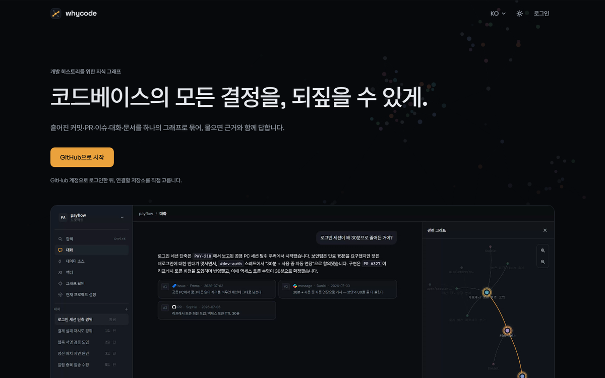
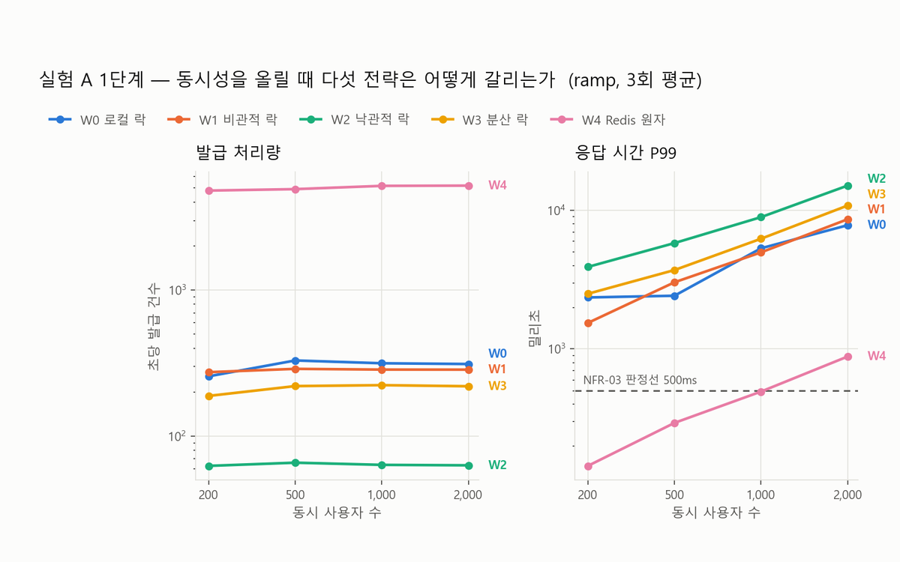
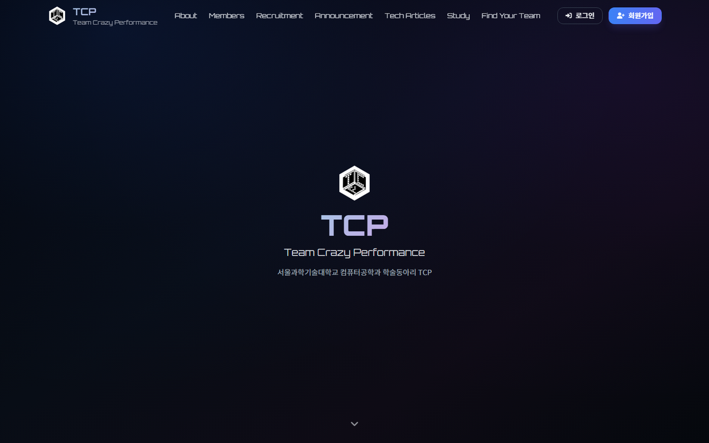

<h1 align="center">정세영 · Backend Developer</h1>

  답을 받는 데서 멈추지 않고, 근거와 적용 범위를 끝까지 따져 직접 결정하는 백엔드 개발자입니다.

## About Me

- **트레이드오프로 사고합니다.** 빠른 쪽을 고르면 무엇을 내주는지까지 측정해서 확인합니다. coupon-contention-lab에서 Redis 원자 연산은 P99 기준을 통과한 유일한 전략이었지만, Redis가 죽으면 발급 기록 45,868건이 사라진다는 대가도 함께 쟀습니다.
- 협업 데이터를 수집해 지식 그래프로 잇는 **수집 파이프라인**을 만들고, 실서비스([why-code.com](https://why-code.com))로 운영하고 있습니다.
- 서울과학기술대학교 컴퓨터공학과 (2021.03 ~ 2027.02 졸업 예정)

## Tech Stack

| | |
|---|---|
| **Language** |   |
| **Backend** |   |
| **Data** |     |
| **Infra · Ops** |       |

## Projects

<table>
  <tr>
    <td width="33%" valign="top">
      
      <h3><a href="https://github.com/se-zero/history-tracker">history-tracker</a></h3>
      
분산된 협업 데이터를 수집해 데이터 간 의미적 관계를 명시하는 지식 그래프를 구축하고, GraphRAG 기반 AI 추론 엔진으로 사용자의 자연어 질의에 코드 변경의 맥락과 의사결정 배경을 자동으로 설명하는 서비스

      
2026.03 ~ 진행 중 · 2인 팀 (캡스톤디자인) <b>수집 파이프라인 담당</b>

      <ul>
        <li>GitHub 수집 약 10분 → <b>2분 42초</b></li>
        <li>초기 수집 약 54분 → <b>30분</b> (약 2.1배)</li>
        <li>Slack rate limit 429로 수집이 반복 중단되던 문제 해결</li>
      </ul>
      
<code>Spring Boot</code> <code>FastAPI</code> <code>RabbitMQ</code> <code>Neo4j</code> <code>PostgreSQL</code>

      
<a href="https://why-code.com">Site</a> · <a href="https://github.com/se-zero/history-tracker">Repo</a>

    </td>
    <td width="33%" valign="top">
      <a href="https://github.com/se-zero/coupon-contention-lab">
        <picture>
          <source media="(prefers-color-scheme: dark)" srcset="assets/coupon-dark.png">
          
        </picture>
      </a>
      <h3><a href="https://github.com/se-zero/coupon-contention-lab">coupon-contention-lab</a></h3>
      
선착순 쿠폰 발급의 재고 차감 전략 5개와 캐시 전략 5개를 같은 조건에서 3회씩 측정해 설계를 정한 실험 프로젝트

      
2026.09 · 개인 프로젝트

      <ul>
        <li>서버 3대에서 JVM 로컬 락이 <b>50,000건 초과 발급</b>하는 것을 재현</li>
        <li>Redis 원자 연산만 P99 500ms 기준 통과, 처리량 <b>16배</b></li>
        <li>캐시 스탬피드를 실제로 줄인 건 뮤텍스뿐임을 확인</li>
      </ul>
      
<code>Spring Boot</code> <code>Redis</code> <code>PostgreSQL</code> <code>k6</code> <code>Grafana</code>

      
<a href="https://github.com/se-zero/coupon-contention-lab">Repo</a> · <a href="https://github.com/se-zero/coupon-contention-lab/blob/main/ARCHITECTURE.md">설계 문서</a>

    </td>
    <td width="33%" valign="top">
      
      <h3><a href="https://github.com/TeamCrazyPerformance/TCP_Website_2025">TCP_Website_2025</a></h3>
      
서울과학기술대학교 컴퓨터공학과 학술동아리 TCP의 공식 웹사이트

      
2025.06 ~ 2026.02 · 5인 팀 <b>백엔드 담당</b>

      <ul>
        <li>회원·팀·공지사항·관리자 API 개발</li>
        <li>API 응답의 개인정보 노출 수정</li>
        <li>현재 후배 기수가 이어받아 운영 중</li>
      </ul>
      
<code>NestJS</code> <code>TypeORM</code> <code>PostgreSQL</code> <code>Docker</code> <code>ELK</code>

      
<a href="https://teamcrazyperformance.com">Site</a> · <a href="https://github.com/TeamCrazyPerformance/TCP_Website_2025">Repo</a> · <a href="https://github.com/TeamCrazyPerformance/TCP_Website_2025/pulls?q=is%3Apr+author%3Ase-zero">내 PR</a>

    </td>
  </tr>
</table>

## Contact

📧 jso8831@naver.com
